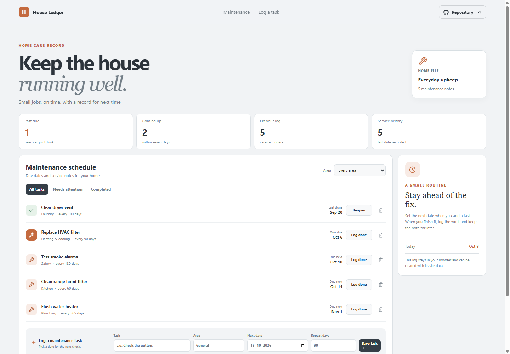

# House Ledger: Home Maintenance Log

House Ledger keeps recurring home-care work and service dates together. It is intended for small household reminders such as filters, alarms, vents, and seasonal checks.

**GitHub Pages URL:** https://a2rp.github.io/home-maintenance-log/ (available after deployment)

## Included

- Track maintenance title, home area, next due date, and repeat interval.
- See past-due and next-seven-day counts at a glance.
- Filter the schedule by area, attention needed, or completed status.
- Log completed work and reopen an entry if it needs attention again.
- Delete a maintenance note through a confirmation dialog.

## How to use it

Add a task, area, due date, and repeat interval. When the work is done, select Log done; the item moves to Completed with its last-recorded date. Reopen restores it to the active schedule.

## Data and limits

Maintenance notes live in localStorage in this browser. Logging work records the date completed. The app does not send reminders or calculate costs.

This is a browser-only utility. Clearing the browser’s site data removes its saved information.

## Run locally

~~~sh
npm install
npm run dev
~~~

## Checks and deployment

~~~sh
npm run lint
npm run build
npm run deploy
~~~

The deploy command builds the project and publishes the dist directory to the gh-pages branch. It requires the project’s public GitHub repository to be configured as origin.

## Future improvements

Ideas only. These are not implemented yet:

- Add photo and receipt attachments.
- Send calendar reminders for due dates.
- Export a home service history for a move or sale.

## Links

- Portfolio: [https://www.ashishranjan.net](https://www.ashishranjan.net)
- GitHub: [https://github.com/a2rp](https://github.com/a2rp)
- CodePen: [https://codepen.io/ash1198](https://codepen.io/ash1198)
- LinkedIn: [https://www.linkedin.com/in/aashishranjan](https://www.linkedin.com/in/aashishranjan)
- Facebook: [https://www.facebook.com/theash.ashish/](https://www.facebook.com/theash.ashish/)
- YouTube: [https://www.youtube.com/@ashishranjan-ashz?sub_confirmation=1](https://www.youtube.com/@ashishranjan-ashz?sub_confirmation=1)
- Email: [mailto:ash.ranjan09@gmail.com](mailto:ash.ranjan09@gmail.com)

## Support

- Support: [https://a2rp-donation-page.netlify.app/](https://a2rp-donation-page.netlify.app/)
- Buy Me a Coffee: [https://buymeacoffee.com/ashishranjan](https://buymeacoffee.com/ashishranjan)
- Patreon: [https://www.patreon.com/ashishranjan](https://www.patreon.com/ashishranjan)